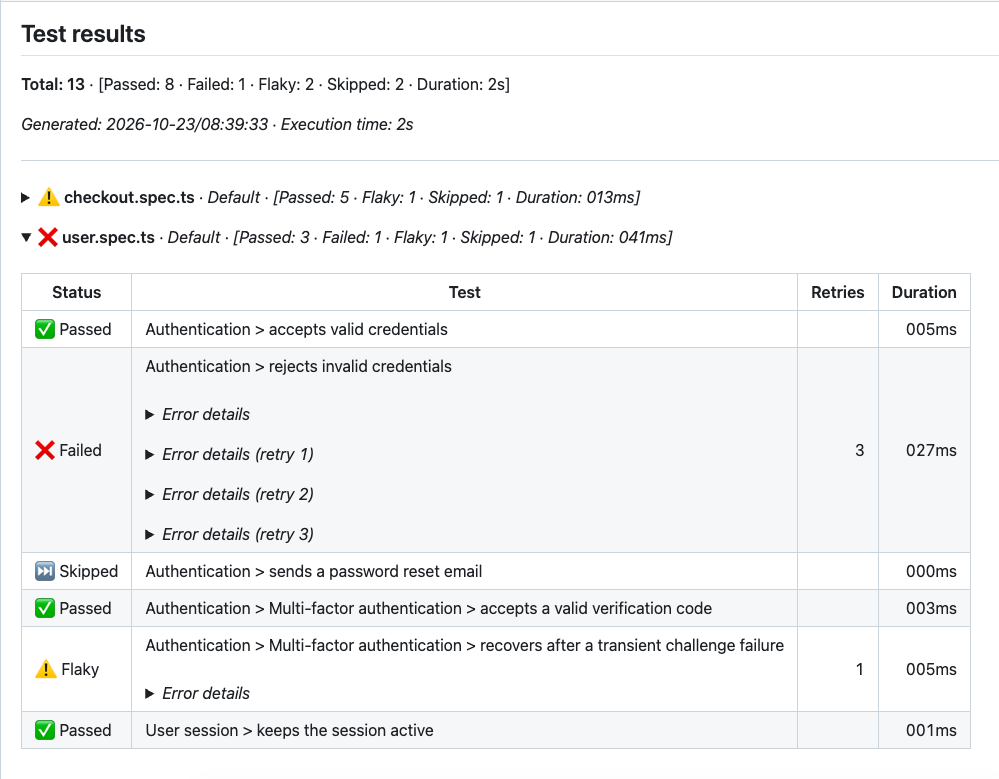

# Playwright GitHub Actions Reporter



## Install

```sh
npm install --save-dev @packageio/playwright-github-actions-reporter
```

The package requires Node.js 18 or newer and `@playwright/test` 1.40 or newer.

## Configure Playwright

Add the reporter to your `playwright.config.ts`. Keep any other reporters you already use in the array:

```ts
import { defineConfig } from '@playwright/test';

export default defineConfig({
	reporter: [
		['list'],
		['@packageio/playwright-github-actions-reporter'],
	],
});
```

## Use in GitHub Actions

For example, with an npm project and a `playwright.config.ts` configured as above:

```yaml
name: Playwright tests

on:
  push:
    branches: [main]
  pull_request:

jobs:
  playwright:
    runs-on: ubuntu-latest
    steps:
      - uses: actions/checkout@v4
      - uses: actions/setup-node@v4
        with:
          node-version: 20
          cache: npm
      - run: npm ci
      - run: npx playwright install --with-deps
      - run: npx playwright test
```

No additional workflow permissions or reporter-specific action steps are needed.

## What the report shows

- Overall and per-file counts for passed, failed, flaky, and skipped tests. Counts are shown only for outcomes that occurred.
- Test duration and retry count. Duration includes all attempts.
- Playwright tags, such as `@smoke` (shown as `smoke`).
- Test annotations and collapsible error details, including errors from retries.
- File groups organized by Playwright project.

The reporter prints its package name and version when a test run starts. Outside GitHub Actions, it does not write a summary file; run it locally to see the usual Playwright reporter output.

## Tags and metadata

Playwright tags appear in each test row. You can also show key/value metadata by adding an annotation whose description is a JSON array of objects with `key` and `value` fields:

```ts
import { test } from '@playwright/test';

test('adds an item to the cart', {
	tag: ['@smoke', '@cart'],
	annotation: {
		type: 'metadata',
		description: JSON.stringify([
			{ key: 'owner', value: 'checkout-team' },
			{ key: 'component', value: 'cart' },
		]),
	},
}, async ({ page }) => {
	// test steps
});
```

The report displays those values as `owner.checkout-team` and `component.cart`. Other annotations appear with the test, and HTTP(S) links in annotation descriptions are clickable.
